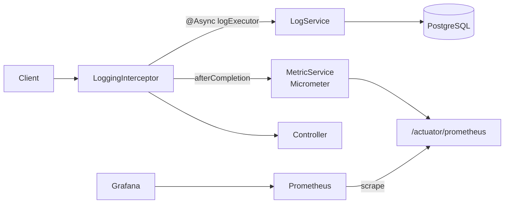

# Request Logging Service

A Spring Boot service that transparently records every HTTP request hitting the application, persists the records asynchronously to PostgreSQL, and exposes them through a secured REST API, a server-rendered dashboard, and Prometheus/Grafana metrics.

It demonstrates the pieces a real backend needs around a simple idea: non-blocking persistence, caching, authentication, schema migrations, observability, and containerized infrastructure.

## Highlights

- **Transparent request capture.** A Spring MVC `HandlerInterceptor` records path, method, status, duration, and the authenticated user for every request, with no changes to controllers.
- **Non-blocking persistence.** Log rows are written on a dedicated, bounded thread pool, so a slow database never delays the HTTP response. The pool uses `CallerRunsPolicy` for backpressure and drains gracefully on shutdown, so logs are not silently dropped.
- **Correct timing for async endpoints.** Handlers returning `CompletableFuture` trigger `preHandle` twice; the interceptor keeps the original start time so durations are measured end to end.
- **Secured by default.** Spring Security with HTTP Basic, stateless sessions, and role-based access. Credentials come from environment variables, not source code.
- **Observability.** Micrometer counters and a timer exposed at `/actuator/prometheus`, scraped by Prometheus and visualized in Grafana.
- **Cached counters.** Total log count is cached with Caffeine (10 s TTL) to avoid a `COUNT(*)` on every call.
- **Schema under version control.** Database schema is managed with Flyway migrations, including indexes for the hot query paths.
- **One-command infrastructure.** PostgreSQL, Prometheus, and Grafana run via Docker Compose.

## Architecture



**Request flow**

1. `preHandle` stores the request start time (only once, so async re-dispatch does not reset it).
2. After the response completes, `afterCompletion` computes duration and final status (exceptions are reported as 5xx).
3. Metrics are updated first, so a database failure can never affect them.
4. The log entry is handed to `LogService.saveAsync`, which runs on the `logExecutor` pool.
5. Paths `/logs/**`, `/actuator/**`, `/error`, and `/favicon.ico` are excluded to avoid feedback loops.

## Tech stack

| Area | Technology |
|---|---|
| Language / framework | Java, Spring Boot 4 (Web MVC, Data JPA, Validation) |
| Security | Spring Security (HTTP Basic, BCrypt, stateless) |
| Database | PostgreSQL 16, Flyway migrations |
| Caching | Spring Cache with Caffeine |
| Metrics | Micrometer, Prometheus, Grafana |
| UI | Server-rendered dashboard (Thymeleaf) |
| Build / tooling | Maven (wrapper included), Lombok, Docker Compose |

## Getting started

### Prerequisites

- JDK 21 or newer
- Docker with the Compose plugin (`docker compose`)

### 1. Configure

```bash
cp .env.example .env     # then edit the passwords
```

| Variable | Default | Purpose |
|---|---|---|
| `DB_NAME` / `DB_USER` / `DB_PASSWORD` | `requestlog` | PostgreSQL credentials |
| `DB_HOST` / `DB_PORT` | `localhost` / `5432` | Database location |
| `ADMIN_USERNAME` / `ADMIN_PASSWORD` | `admin` / `change-me` | API and dashboard login |
| `SPRING_PROFILES_ACTIVE` | `dev` | `dev` enables the demo endpoints |

### 2. Prepare Prometheus credentials

Prometheus scrapes a protected endpoint, so it needs the admin password in a file:

```bash
mkdir -p prometheus
set -a; source .env; set +a
printf '%s' "$ADMIN_PASSWORD" > prometheus/admin_password
```

### 3. Start infrastructure and the app

```bash
docker compose up -d     # PostgreSQL, Prometheus, Grafana
./mvnw spring-boot:run
```

| Service | URL |
|---|---|
| Application | http://localhost:8080 |
| Dashboard | http://localhost:8080/dashboard |
| Prometheus | http://localhost:9090 |
| Grafana | http://localhost:3000 |

> **Linux note:** Prometheus runs in a container and scrapes the app on the host via `host.docker.internal`. If your firewall blocks container-to-host traffic (for example firewalld on Fedora), allow the Docker subnets:
> `sudo firewall-cmd --permanent --zone=trusted --add-source=172.16.0.0/12 && sudo firewall-cmd --reload`

### 4. Try it

```bash
curl http://localhost:8080/ok
curl http://localhost:8080/fail            # 500, recorded as an error
curl http://localhost:8080/async-slow      # ~3 s, duration recorded correctly

curl -u admin:<password> "http://localhost:8080/logs?size=5"
curl -u admin:<password> http://localhost:8080/logs/count
curl -u admin:<password> http://localhost:8080/logs/metrics/latency
```

## API

All `/logs/**`, `/dashboard`, and `/actuator/**` endpoints require the `ADMIN` role.

| Method | Path | Description |
|---|---|---|
| GET | `/logs?page=0&size=50` | Paginated logs, newest first (max size 200) |
| GET | `/logs/user/{userId}` | Logs for a user, paginated |
| GET | `/logs/count` | Total number of logs (cached 10 s) |
| GET | `/logs/async`, `/logs/async/user/{userId}` | Same queries, served asynchronously |
| GET | `/logs/metrics/latency` | Request count, mean and max latency (ms) |
| POST | `/logs` | Create a log entry manually (`201 Created`, validated) |
| GET | `/dashboard` | Top 10 slowest requests |
| GET | `/actuator/prometheus` | Prometheus metrics |

Demo endpoints (profile `dev` only): `/ok`, `/slow` (blocking 3 s), `/async-slow` (non-blocking 3 s), `/cpu-bound`, `/fail`.

**Example: create a log entry**

```bash
curl -u admin:<password> -X POST http://localhost:8080/logs \
  -H "Content-Type: application/json" \
  -d '{"path":"/demo","method":"GET","status":200,"duration":120,"userId":"user1"}'
```

Invalid payloads (blank path, status outside 100–599, negative duration) return `400`.

## Monitoring

Exposed metrics:

- `http_requests_total`
- `http_requests_errors_total`
- `http_request_duration_seconds_count`, `_sum`, `_max`

Add Prometheus as a Grafana data source (`http://prometheus:9090`) and use these queries:

| Panel | PromQL |
|---|---|
| Requests per second | `rate(http_requests_total[1m])` |
| Error ratio | `rate(http_requests_errors_total[1m]) / rate(http_requests_total[1m])` |
| Average latency (s) | `rate(http_request_duration_seconds_sum[1m]) / rate(http_request_duration_seconds_count[1m])` |
| Max latency (s) | `http_request_duration_seconds_max` |

## Design decisions

- **Separate executors.** Log writes use their own pool (4–8 threads, sized below the default Hikari pool of 10 connections). Async reads and demo endpoints use a different pool so they cannot starve log persistence.
- **Short-TTL cache instead of eviction.** Evicting the count cache on every write made it useless under load; a 10-second TTL keeps it effective and removes stale-write races.
- **Metrics before persistence.** Counters and timers are updated before the database write is attempted, so persistence failures never hide traffic.
- **Bounded reads.** List endpoints are paginated with an enforced maximum page size instead of returning the full table.
- **Demo code isolated.** Slow, CPU-bound, and failing endpoints exist only under the `dev` profile so they cannot be abused in production.
- **Stateless security.** CSRF protection is disabled deliberately because the API is stateless (HTTP Basic, no session cookies).

## Project structure

```
src/main/java/com/example/requestlog
├── RequestLogApplication.java
├── config        # Async, Cache, Security, WebMvc
├── controller    # Log API, dashboard, demo endpoints
├── dto           # Request validation (records)
├── entity        # RequestLog (JPA, indexed)
├── interceptor   # LoggingInterceptor
├── repository    # Spring Data JPA
└── service       # LogService, MetricService, AsyncService
src/main/resources
├── application.properties
└── db/migration  # Flyway migrations
docker-compose.yml        # PostgreSQL, Prometheus, Grafana
prometheus/prometheus.yml # scrape configuration
```

## Possible improvements

- Integration tests with Testcontainers (PostgreSQL) and MockMvc for the security rules.
- Log retention: scheduled cleanup or table partitioning by `created_at`.
- Batch inserts to reduce write amplification under high load.
- Replace in-memory users with JWT or an external identity provider.
- Provision Grafana dashboards and data source as code.
- Containerize the application itself and add a CI pipeline.

